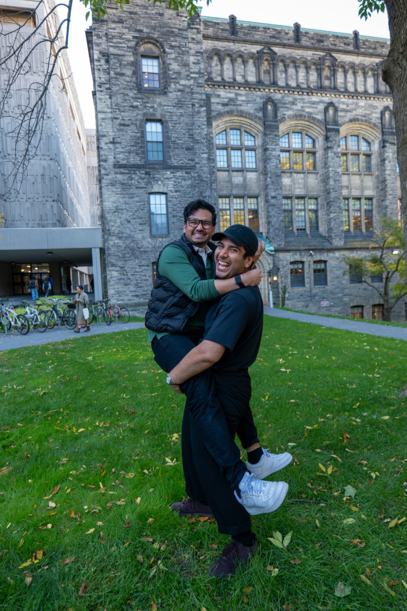
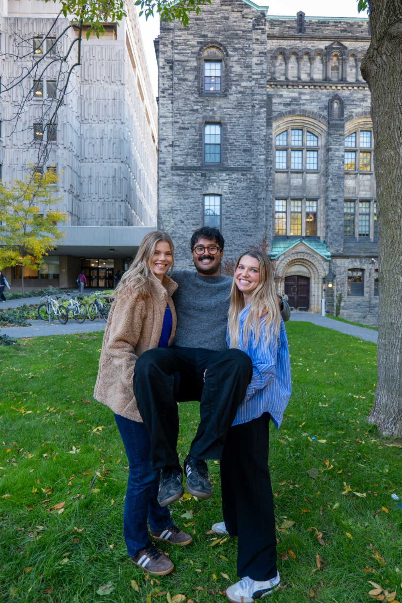
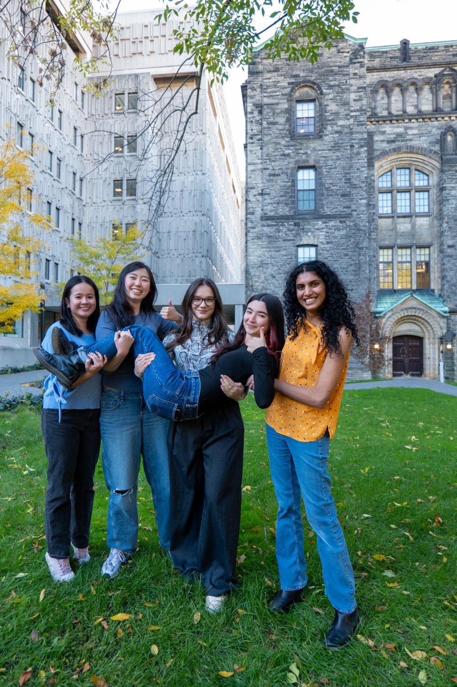
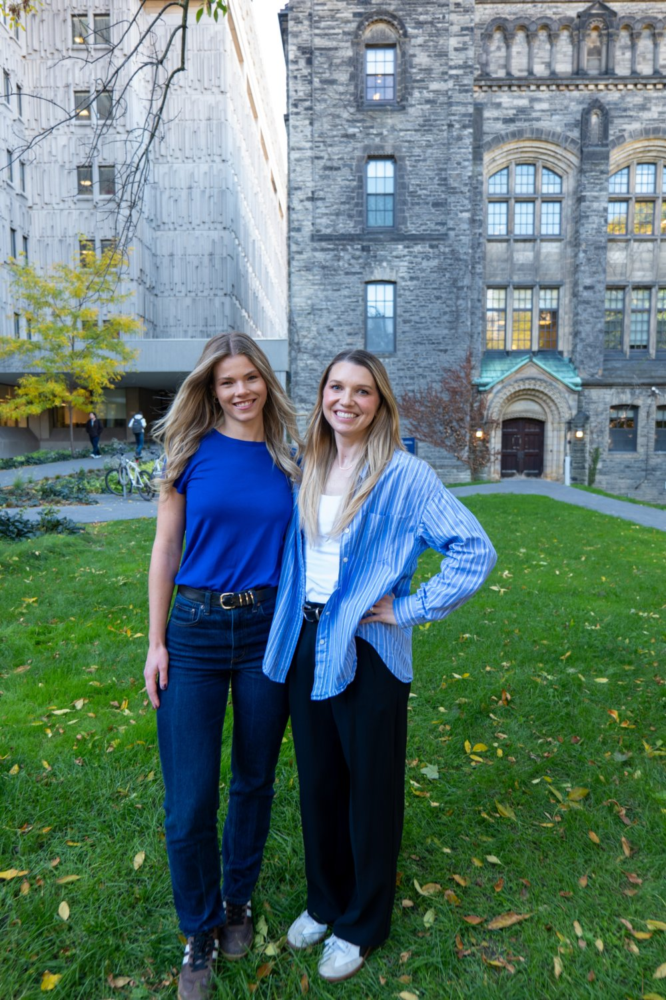
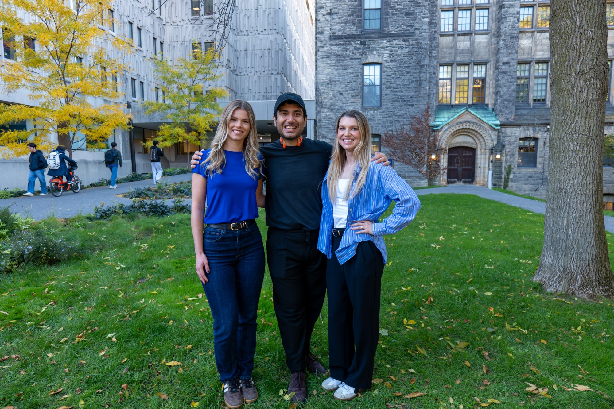
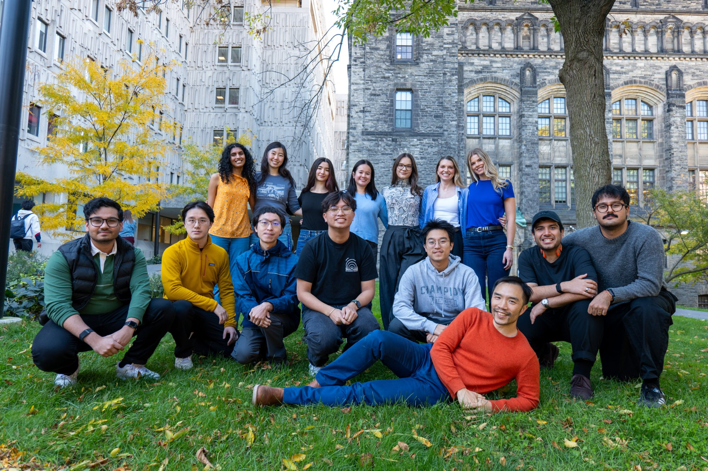
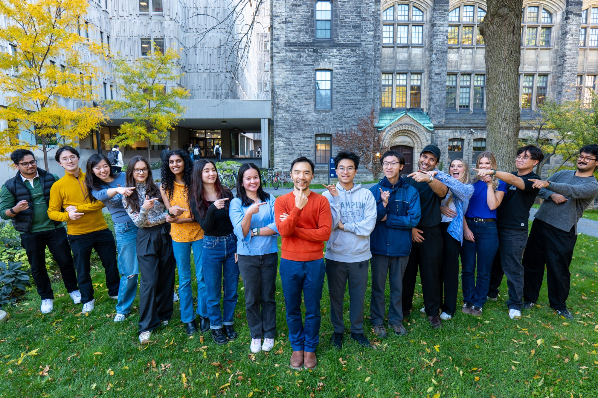
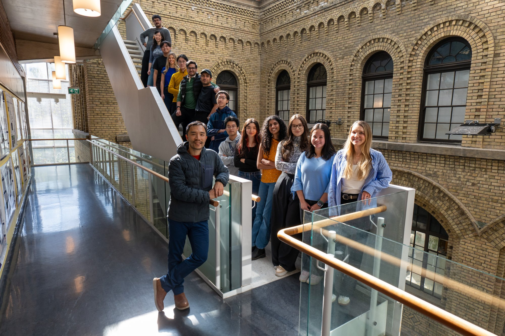
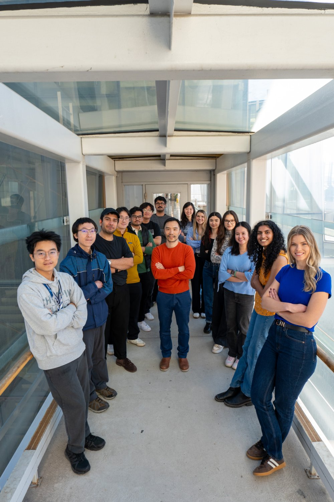

This year, we experimented with one day of 'big picture' science, where everyone comes up with ideas for the next 10 years via a chalk talk. We also discussed how lab mysteries — unexpected results — could be converted into projects.

<!--more-->

 
 
 
 
 
 
 
 
